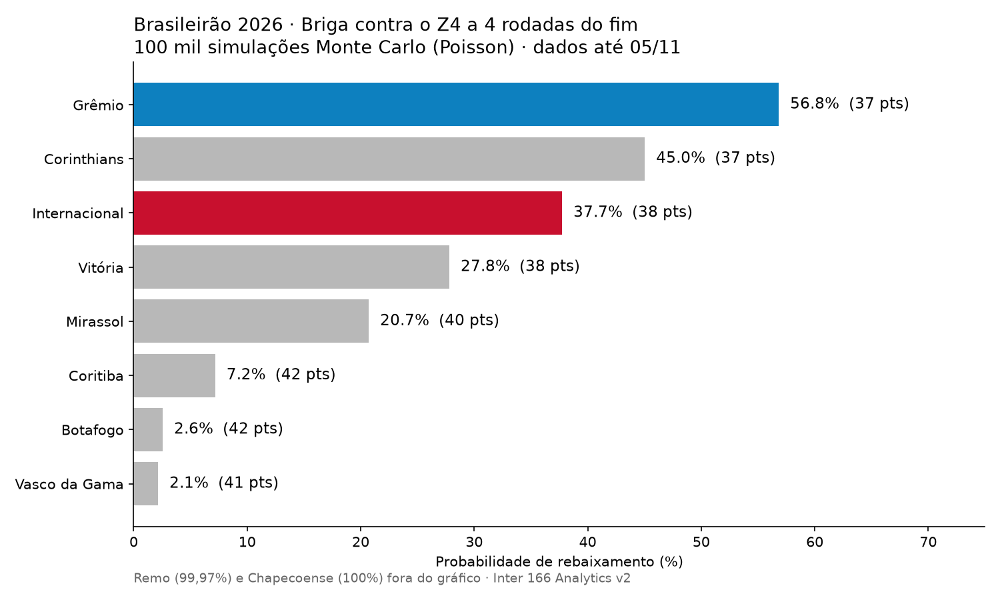

# Inter 166 Analytics: v2 (novembro/2026)

## 1. O que a v1 tinha de problema

| # | Problema | Por que importa |
|---|----------|-----------------|
| 1 | **As probabilidades não fecham.** No CSV da v1, a chance de título soma 428% e a de rebaixamento soma 1.064% (deveriam dar 100% e 400%). | Cada time foi avaliado isolado, sem considerar que só existe 1 campeão e 4 rebaixados. |
| 2 | **O SMOTE distorce as probabilidades.** Ele balanceia as classes artificialmente, então o `predict_proba` passa a refletir um mundo com 50% de rebaixados. | Para classificar (cai/não cai) o SMOTE até ajuda. Para dar porcentagem, atrapalha. Melhor usar `class_weight` ou calibrar. |
| 3 | **O CSV não bate com a regressão logística.** São Paulo com 16 pts aparece com 39% de título e Palmeiras com 13 pts aparece com 71%. Uma logística com uma única variável é monotônica, então isso não poderia acontecer. | Indica que o CSV saiu de outro modelo (provavelmente o Random Forest, pela ordem das células) ou de uma variável sobrescrita no notebook. |
| 4 | **Bug na temporada de 2020.** `ano = data.year` coloca os jogos de jan/fev de 2021 (temporada 2020, adiada pela pandemia) dentro de "2021". | A tabela final de 2020 e a de 2021 ficam erradas, e com elas os rótulos de rebaixado/campeão. |
| 5 | **Split aleatório de linhas.** Times da mesma temporada caem no treino e no teste ao mesmo tempo. | Vaza informação. O certo é separar por temporada (ex.: treina 2006–2019, testa 2021–2024). |
| 6 | **Uma única variável (pontos).** Ignora jogos disputados (o próprio README cita times com 5 jogos), saldo de gols e a tabela que ainda falta. | 6 pontos em 5 jogos não é o mesmo que 6 pontos em 6 jogos. |
| 7 | **Posição final só por pontos** (`rank(method='first')`). | Ignora os critérios de desempate (vitórias, saldo, gols pró). |
| 8 | **Scraper frágil**: `iloc[:, [1, 2]]` depende da ordem das colunas, e o nome do time vem com "(Q)"/"(R)". | Quebra quando a Wikipedia muda o layout. |
| 9 | **Engenharia**: o README fala em notebook e MySQL, mas o código é um `.py` com células e grava CSV. O `requirements.txt` não tinha `lxml`/`html5lib`. Não há testes nem versão fixa das bibliotecas. | Reprodutibilidade. |

## 2. O que mudou na v2 (`simulacao_monte_carlo.py`)

Mudei a pergunta. Antes era "times com X pontos na rodada 6 costumam cair?". Agora é "simulando os jogos que faltam, em quantos mundos cada time cai?".

1. **Coleta**: raspa a classificação **e a matriz de confrontos** da Wikipedia. A partir dela saem os 338 jogos disputados (com placar) e os 42 que faltam. Os jogos restantes são conferidos contra `38 - J` de cada time.
2. **Modelo de gols (Poisson)**: `log(gols) = ataque[time] − defesa[adversário] + mando`, com regularização L2. O mando de campo estimado em 2026 é de **1,35x gols**.
3. **Monte Carlo**: 100 mil simulações dos 42 jogos, com os critérios de desempate do regulamento.
4. **Saídas**: `previsoes_brasileirao_2026_v2.csv` (título/G4/G6/Sula/Z4), `distribuicao_posicoes_2026.csv` (P de cada posição, ótimo para heatmap no Power BI), `jogos_restantes_probabilidades.csv` (1X2 de cada jogo).
5. **Coerência garantida**: título soma 100,0% e rebaixamento soma 400,0%.

## 3. Próximos passos sugeridos

- **Backtest honesto**: rodar a simulação "congelada" na rodada 34 de 2015–2025 e medir Brier score/log-loss contra o que aconteceu.
- **Dixon-Coles + decaimento temporal**: dar mais peso aos jogos recentes e corrigir a subestimação de 0x0 e 1x1.
- **Prior de pré-temporada / Elo**: útil no início do campeonato (era o problema da rodada 6 na v1).
- **Automatizar**: GitHub Action rodando após cada rodada e gravando o histórico das probabilidades. Dá para fazer o gráfico "evolução da chance de queda do Inter rodada a rodada".
- **Estrutura**: `src/` (coleta, modelo, simulação), `tests/`, `requirements` com versão fixa e um notebook só para a narrativa.

## 4. Resultado (dados até 05/11/2026, 4 rodadas para o fim)

| Time | Pts | Título | G4 | Z4 |
|---|---|---|---|---|
| Flamengo | 76 | **83,1%** | 100% | – |
| Palmeiras | 73 | 16,9% | 100% | – |
| Cruzeiro | 60 | – | 97,0% | – |
| Fluminense | 54 (33j) | – | 58,0% | – |
| Athletico-PR | 54 | – | 25,4% | – |
| Bahia | 53 | – | 16,2% | – |
| Mirassol | 40 | – | – | 20,7% |
| Vitória | 38 (33j) | – | – | 27,8% |
| **Internacional** | 38 | – | – | **37,7%** |
| Corinthians | 37 | – | – | 45,0% |
| **Grêmio** | 37 | – | – | **56,8%** |
| Remo | 29 | – | – | 99,97% |
| Chapecoense | 21 | – | – | 100% |

**Inter**: os jogos restantes são Bragantino (casa), Vitória (casa), Cruzeiro (fora) e Vasco (fora).
- Terminar com **44 pontos** (2 vitórias) deixa o risco de queda em ~6,5%. Com **45**, cai para ~1,4%.
- A linha de corte mais provável fica entre 42 e 44 pontos.
- Grenal da sobrevivência: 17% de chance de os dois caírem, 22% de nenhum cair, e 65% de o Inter terminar acima do Grêmio.

---

## 5. Rascunho do post (LinkedIn)

> Em março publiquei o **Inter 166 Analytics**, um modelo que tentava prever o destino do Inter no Brasileirão a partir da 6ª rodada. Faltando 4 rodadas, voltei ao projeto para ver o que deu certo e o que não deu.
>
> **A autocrítica:** a v1 dava ao Inter 82% de chance de queda, e somando a chance de título de todos os times dava 428%. Só existe um campeão. O modelo olhava cada time isolado, e o SMOTE (que usei para balancear as classes) inflava as probabilidades.
>
> **A v2** muda a pergunta: em vez de "times com X pontos costumam cair?", ela simula os 42 jogos que faltam, 100 mil vezes.
> 🔹 Modelo de Poisson com força de ataque, defesa e mando de campo de cada time (em 2026 o mandante marca 1,35x mais)
> 🔹 Monte Carlo com os critérios de desempate do regulamento
> 🔹 Probabilidades coerentes por construção: título soma 100% e Z4 soma 400%
>
> **O que os números dizem hoje:**
> 🏆 Flamengo 83% x Palmeiras 17% pelo título
> ⬇️ Remo e Chapecoense praticamente rebaixados. As outras duas vagas do Z4 estão entre Grêmio (57%), Corinthians (45%), **Inter (38%)**, Vitória (28%) e Mirassol (21%)
> 🔴 O número mágico do Inter é **44 pontos**: com duas vitórias em quatro jogos, o risco cai para ~6%
>
> Lição principal: dá para ter um modelo com bom F1-score e mesmo assim errar as probabilidades. Se a saída é uma porcentagem, ela precisa fazer sentido como porcentagem.
>
> Código no GitHub 👇 [link]
> #DataScience #Python #MachineLearning #MonteCarlo #Futebol #Brasileirão #Internacional
